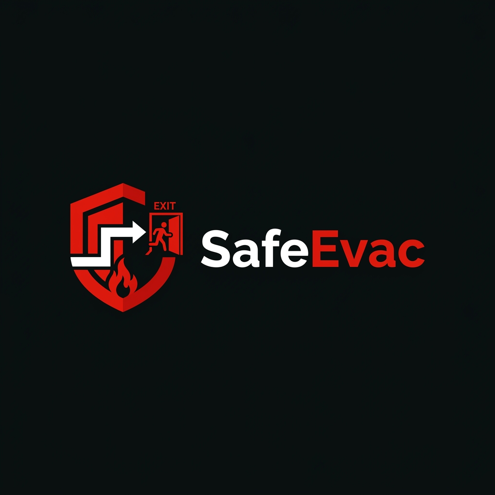

# Welcome to your Lovable project

<p align="center">
  
</p>
## Build with Lovable

Open your project in the [Lovable editor](https://lovable.dev) and keep building.

- **Ship faster**: describe what you want to build and Lovable handles the code.
- **Stay in sync**: connect the project to GitHub and every change made in Lovable is committed straight to your repository.
- **Full ownership**: this code is yours. Push to your repository and your changes sync back into Lovable, ready for your next prompt.

## Development

Prefer working locally? You need Node.js and npm — [install with nvm](https://github.com/nvm-sh/nvm#installing-and-updating).

```sh
git clone <this-repository-url>
cd <repository-name>
npm i
npm run dev
```

## Project links

- **Live demo:** [Live](https://safe-passage-lab.lovable.app/)
- **GitHub:** https://github.com/s333s/SafeEvac
- **Youtube vedio:** [YouTube](https://youtu.be/F49WfV92zNs).

## Built with

- TanStack Start
- TypeScript
- React
- Tailwind CSS
